# 法律咨询小程序

一个**自己家里跑的**法律咨询微信小程序：你用大白话问劳动、租房、买卖、婚姻家庭这类问题，它给出带法条出处的回答，还能直接查条文原文。

不依赖任何云服务——大模型、向量检索、法条库、会话记录全部在你自己的电脑上，手机通过局域网连过去。目前定位是体验版自用 + 朋友小范围试用（个人主体，没有企业/AI 备案资质，所以不上线）。

> **先说清楚**：所有回答都是本地小模型按检索到的条文生成的，**不构成法律意见**，可能有错漏甚至编造条文；诉讼费/时效两个计算器是纯 Python 按公开通用规则算的，具体案件仍以法院和当地标准为准。真要用之前请找执业律师核对。首次进入小程序时也有同样的确认弹窗。

## 它能做什么

**1. 打开就是提问页**，下面是按领域分好的示例问题卡片（劳动、消费、租房、借贷、婚姻家庭…），点一下就能问，也可以自己写。首次进入会先让你确认免责声明。

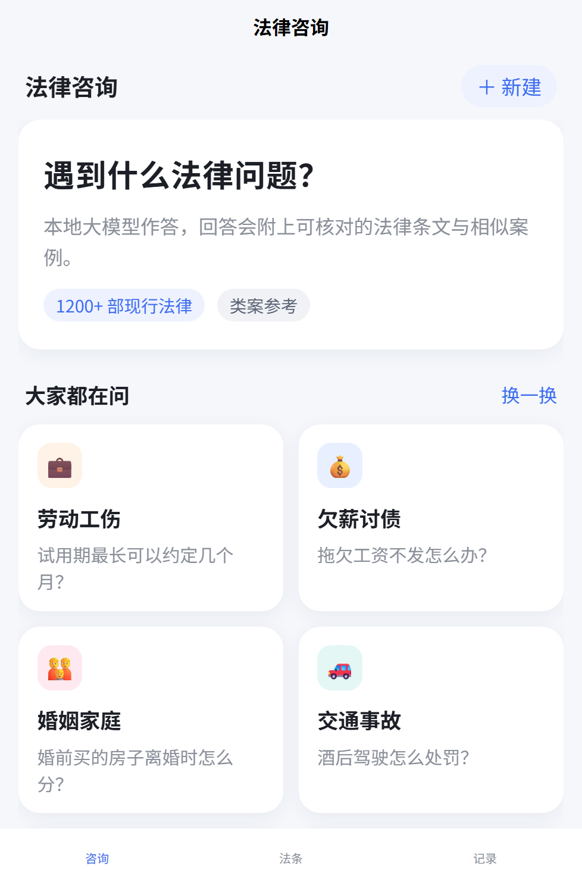

**2. 提问后逐字流式出答案**，答案下面挂着「依据 X 条法条 · X 条类案」，点开就是编号引用卡片——法条是蓝标、带施行日期，类案是灰标，点法条卡片能跳到原文页。

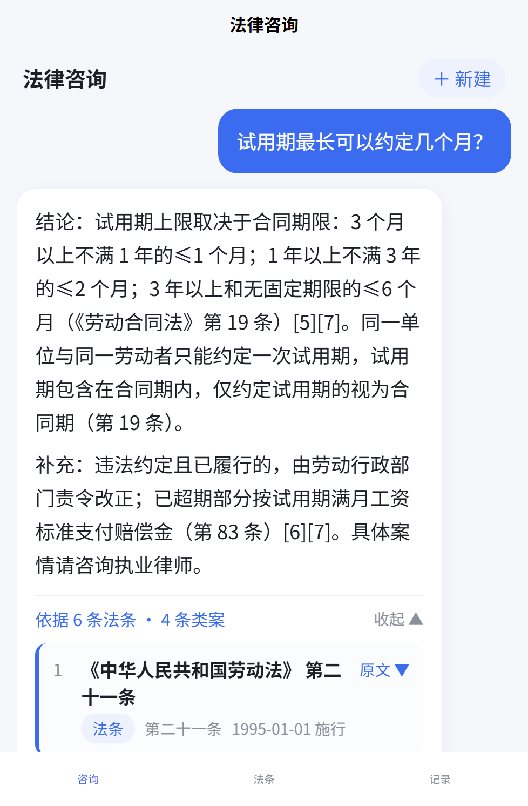

**3. 「法条」tab 是一个能搜的条文库**：本地 1207 部法律法规、52116 条现行条文。支持关键词、条号（「第五百六十三条」）、整部法三种查法，结果按相关度排序。

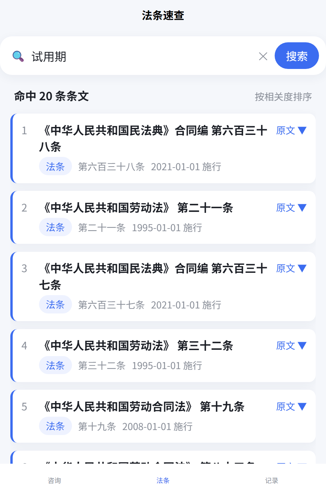

**4. 不想搜也可以按条号整部翻**，12 部常用法在首页网格里，点进去从上往下读。

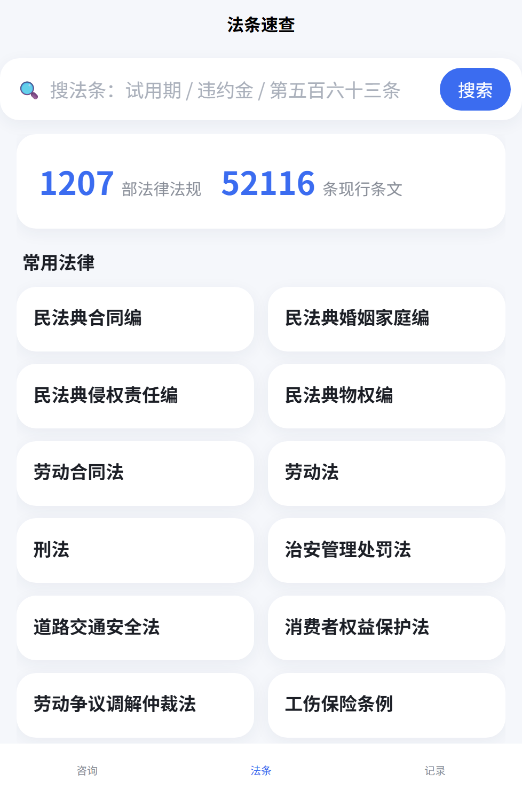

**5. 条文详情页**会把目标条前后各 5 条一起列出来，方便看章节语境，还能「拿这条去咨询」直接跳回提问页。

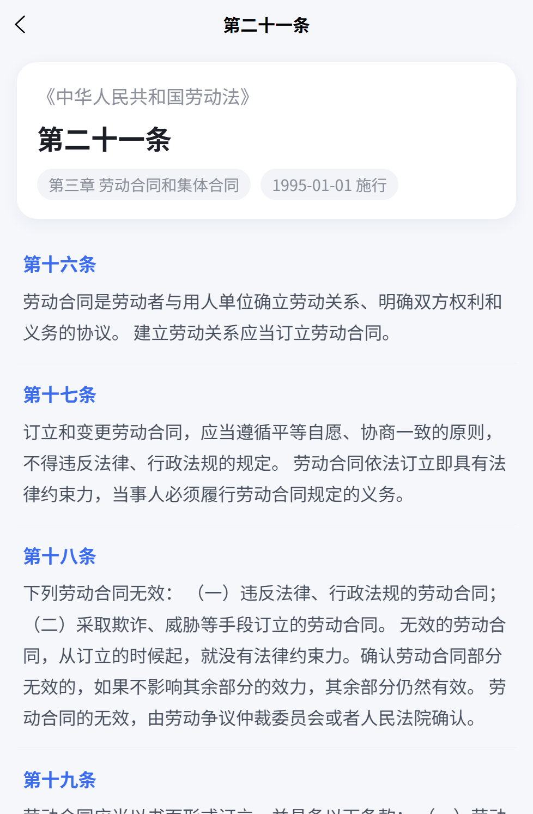

**6. 「记录」tab** 存历史会话，可以改名、删除、点开继续追问；回答支持点赞点踩和复制。

## 工具 tab：算钱、算时间、审合同、出文书

这四件事不用问律师也能自己核对，算法全部写死在后端 Python 里（纯函数、毫秒级），模型只负责「追问建议」和可选的书面语润色，**算出来的每个数都能点开看是哪一条哪一段算的**。

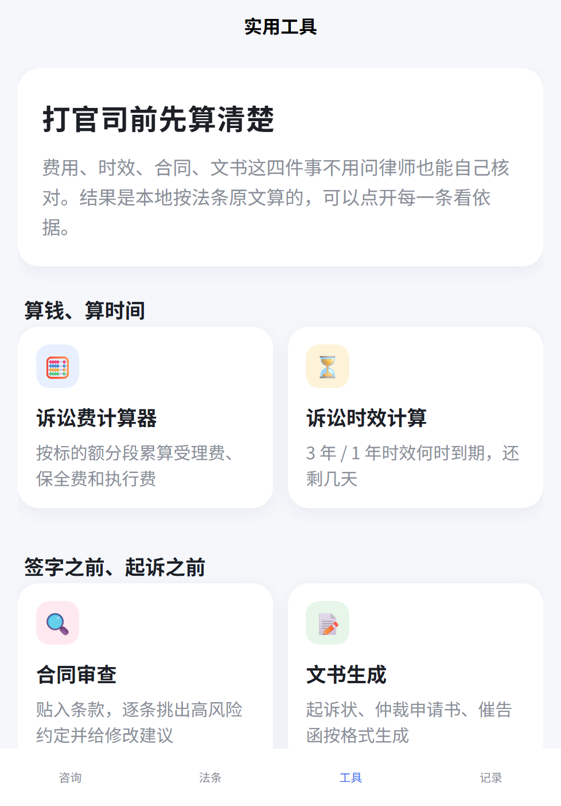

**7. 诉讼费计算器**：按《诉讼费用交纳办法》第 13、14、15、16 条分段累算。财产案件九个档（1 万以下 50 元，1–10 万 2.5%，10–20 万 2%…2000 万以上 0.5%），另算保全申请费（10 万以上 0.5%、封顶 5000 元）、执行申请费、支付令（受理费 1/3）、管辖权异议费；勾「简易程序 / 调解 / 撤诉」自动减半。10 万标的 → 2300 元，减半 1150 元。

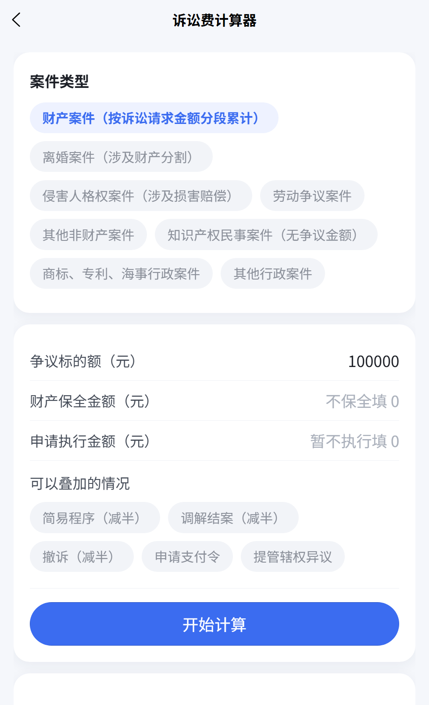

**8. 诉讼时效计算器**：普通 3 年、劳动仲裁 1 年、保险金 2 年、人寿 5 年、国际货物 4 年、最长保护期 20 年，也可自定天数/月数。届满日按《民法典》第 202 条「到期月的对应日」推算（2 月 29 日落到月末，节假日顺延会标注），填了中断日就从那天重新起算，填了中止事由消除日则取「满 6 个月」与原判届满日的较晚者。到期前 90 天内变黄提示。

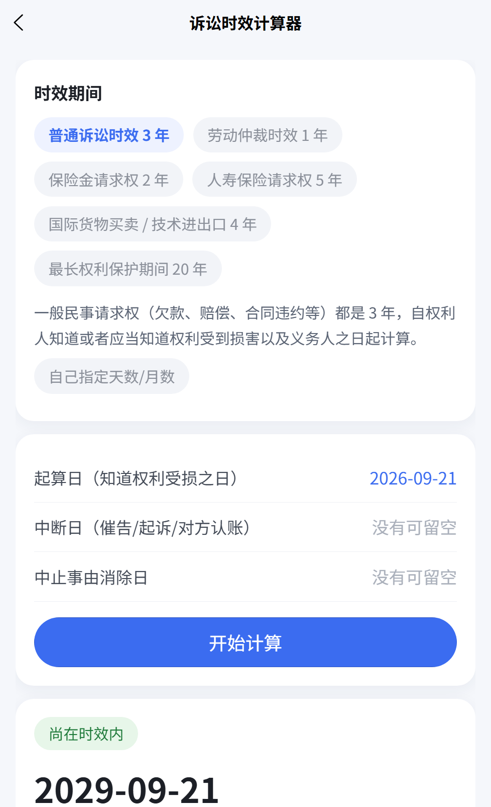

**9. 合同审查**：20 条规则扫全文（试用期超上限、违约金过高、押金写成定金、单方变更权、排除对方主要权利的格式条款、管辖约定不明、日息千分之五折算成年化超过 24%…），按高/中/低风险排序，每条给出问题、改法建议、命中的条文原文位置。模型只额外写一段总体评价，不参与风险判定。

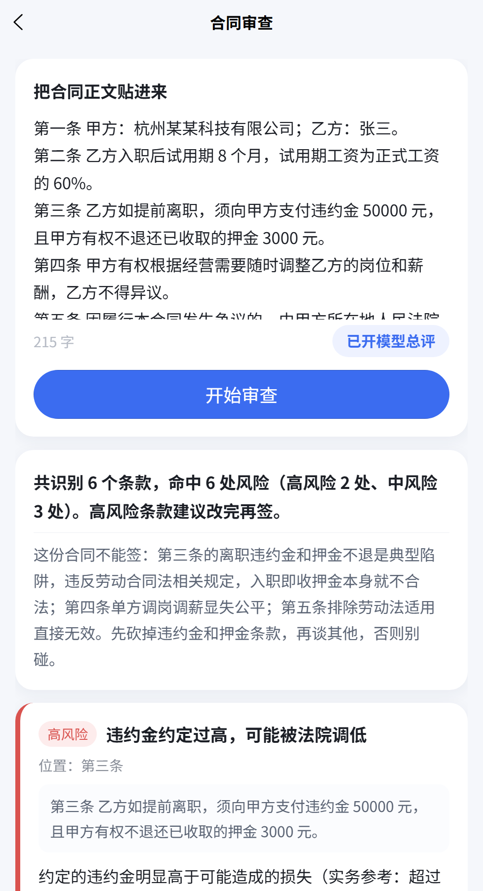

**10. 文书生成**：民事起诉状、劳动人事争议仲裁申请书、催告函三种。正文是固定格式模板 + 你填的字段（此致、具状人、副本份数这些位置不能乱），案由里出现「劳动/工伤/辞退/工资」会拒绝生成起诉状并引导去仲裁。可选让模型把「事实与理由」改成书面语，提示词里明令不得添加你没提供的时间、金额、人名。

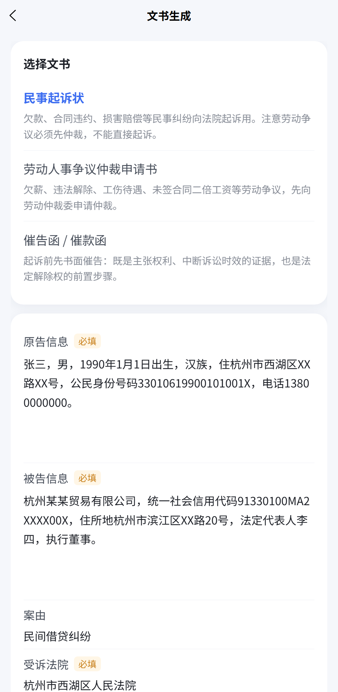

**11. 咨询页新增两块**：回答结束后自动给出 3 条「你可以接着问」（模型出，超时退回领域模板），以及一张按领域识别的**案情要素卡**——从你的问句里已经抽到的（工作时长 3 个月）打勾显示，没抽到的排成输入框，填完点「带上补充再问一次」会拼成结构化问句重新检索一遍。

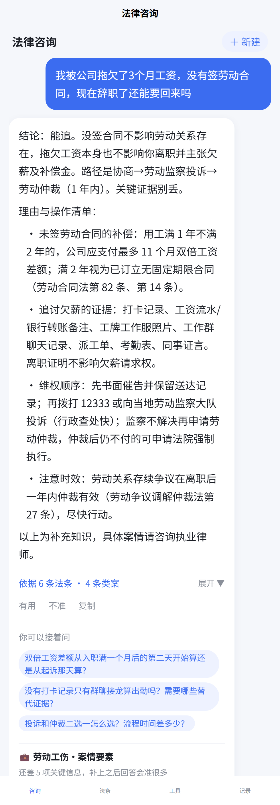

**12. 算完直接接着问**：诉讼费、时效、合同审查、文书生成四个结果页底部都有「带这个结果去咨询」。点一下回到咨询页，输入框里已经填好一段结构化摘要（【诉讼费测算】案件类型、标的额、应交合计…）加上一条针对性问题，摘要原样可见、可改可发，不满意就删掉重打。

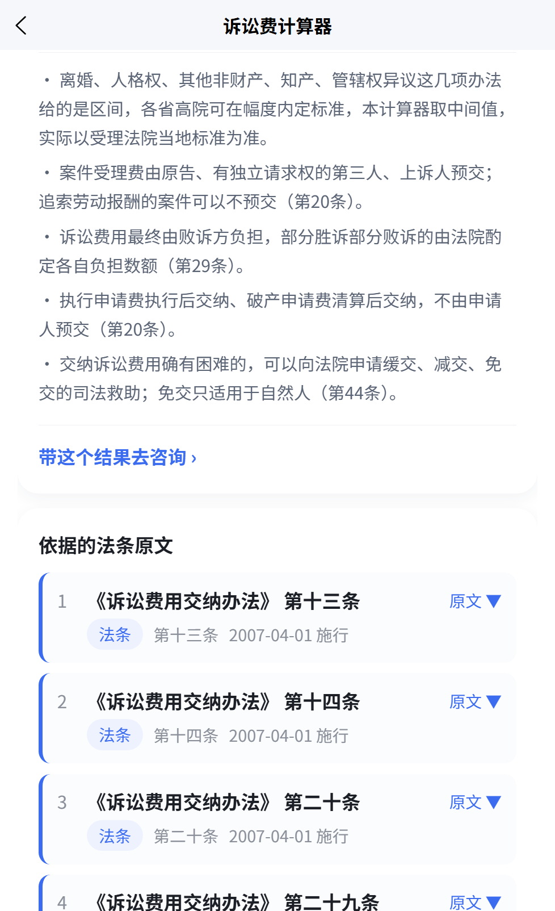

**13. 结果存成长图**：诉讼费、时效两个结果页的「保存分享图」会请求 `/api/share/fee`、`/api/share/limit`，后端用 Pillow 把刚才那张卡片重画成 750px 宽的竖版 PNG（结论、输入条件、每项费用的分段明细和依据、接下来该做什么、法条名、免责声明），直接写进相册发微信。图里的金额和日期由后端按同一套规则再算一遍，前端传过来的数字进不了图，改不动；同一份输入两次生成的字节完全一致。唯一新增依赖是 pillow，字体用系统里的微软雅黑/黑体。

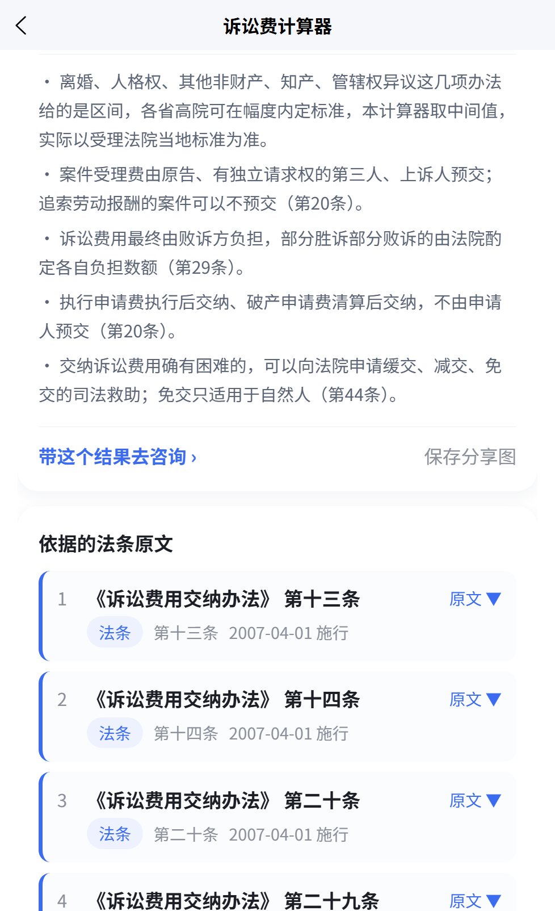

**14. 合同可以直接传文件**：合同审查页顶部多了「从微信聊天选文件」，只收 `.txt` / `.docx`、最大 2 MB。后端 `POST /api/contract/extract` 用标准库 `zipfile` 解 `word/document.xml`（不引 python-docx；Word 把一句话拆成多个 run 也能拼回整句），txt 依次试 UTF-8 / GBK / Big5，超 2 万字按输入框上限截断并说明。解出来的正文原样填回输入框、可继续手改，之后走的还是同一条审查链路——服务端不落盘、不留副本。`.doc` / `.pdf` / `.wps` 会被明确拒掉，并告诉你另存成什么格式。

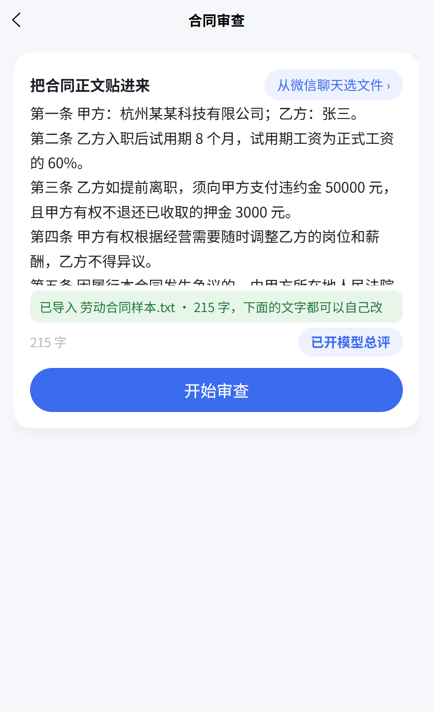

## 一次提问在机器里走了哪条路

```
小程序 (uni-app Vue3 → 微信开发者工具)
   │  http://本机IP:9100
   ▼
backend/  FastAPI 网关（登录、意图分流、SSE 流式、法条检索、会话与反馈、工具接口，SQLite 存储）
   ├─ 法律问题 → ① 本地 laws.db 全文检索（FTS5，找法条）
   │             ② AnythingLLM :3001 mode=query（找相似案例）— 两路并行
   │          → Ollama qwen3.5:9b-legal :11434 生成，逐字推给前端
   ├─ 闲聊     → 直连 Ollama，不检索
   └─ /api/fee /limit /contract /document → 纯 Python 算法 + laws.db 取依据
                              （只有「润色 / 总评 / 追问建议」会额外调一次模型，且带超时兜底）
```

## 目录

```
backend/       FastAPI 网关（登录、意图分流、SSE 对话、法条检索、会话/反馈、工具接口，SQLite 存储）
  app/services/ 检索与业务算法：lawsearch(FTS5) / feecalc(诉讼费) / limcalc(时效) /
                 contract(18 条审查规则) / document(文书模板) / elements(案情要素) / followup(追问建议)
  corpus/laws/ 法条全文语料（Markdown，412 部，import 脚本的输入）
miniprogram/   uni-app Vue3 源码，产物在 dist/build/mp-weixin
tools/         语料导出 / 法条库导入 / 预览出码 / 后端重启 / 截图抓取 / P1 接口自测
docs/          效果图、验收测试报告（HTML/PDF/JSON）
```

`backend/data/`（会话库 law.db、法条库 laws.db）和 `backend/config.json` 不进仓库，按下面两节自行生成。

## 法条速查库（laws.db）

本地 SQLite FTS5，**1207 部法律法规 / 52116 条现行条文**（含 333 部司法解释）。中文没有 FTS 分词器，所以索引里存的是**重叠二元组**，短语查询等价于子串匹配；检索再叠加口语→法条用词的同义词扩展（辞退→解除/解雇、工资→劳动报酬…）和「核心法」先验。刻意宁可返回 0 条也不硬凑——纯口语问题交给 AnythingLLM 的类案向量检索。

```bash
cd backend
.venv/Scripts/python.exe ../tools/export_laws.py   # 从本机 AnythingLLM storage 抽语料到 corpus/laws/
.venv/Scripts/python.exe ../tools/import_laws.py   # 解析「第X条」连续编号，建 data/laws.db（约 108MB）
```

`export_laws.py` 依赖本机 AnythingLLM 桌面版的文档存储路径，换机器跑不了就直接用 `import_laws.py` 吃仓库里的 `corpus/laws/`。

## 启动后端

```bash
cd backend
cp config.example.json config.json   # 填 AnythingLLM apiKey / workspaceSlug
# jwtSecret 务必换成随机值：示例里那个固定值一旦上生产就等于没有鉴权（token 可被伪造）
python -c "import secrets;print(secrets.token_urlsafe(32))"
.venv/Scripts/python.exe -m uvicorn app.main:app --host 0.0.0.0 --port 9100
```

`config.json` 在 `.gitignore` 里，不会被提交。`wechat.appid/secret` 可以留空——留空时登录发 dev 游客 token，本机自用不受影响；两个都填了才会真的调 `jscode2session`。

依赖本机跑着 Ollama（`qwen3.5:9b-legal`，11434）和 AnythingLLM（3001，只做向量检索）。
已验证：health ✓ dev 登录 ✓ 意图分流 ✓ RAG（法条 FTS + 类案向量并行检索 → Ollama 真流式生成）✓ 闲聊直连流式 ✓ 法条搜索/整部浏览/上下条上下文 ✓ 反馈/重命名 ✓。

## 编译小程序

```bash
cd miniprogram
npm run build:mp-weixin   # 已有依赖则直接跑；产物 dist/build/mp-weixin
```

微信开发者工具 → 导入项目 → 选择 `dist/build/mp-weixin`；**详情 → 本地设置 → 勾选「不校验合法域名」**。

## 真机预览（手机与电脑同一 Wi-Fi）

已验证可用。需要把你自己的小程序 AppID 填进 `miniprogram/src/manifest.json` 的 `mp-weixin.appid`（仓库里故意留空）。两个必须绕开的坑：

1. **不能用「小程序测试号」的 AppID**。测试号能编译能跑模拟器，但预览/上传被 DevTools 禁用，点「预览」静默挂到 5 分钟后报 `handleUpload Timeout (code 10)`。判据：`User Data/<hash>/WeappLocalData/localstorage_2351*.json` 里 `"isSandbox":true`、`appName` 显示成「xxx的小程序测试号」。正式个人主体小程序（身份证+管理员手机号登记完成）是 `isSandbox:false` + `adminName` 非空。
2. **项目路径必须是纯 ASCII 的真实目录，不能是 junction、也不能带中文**。打包器解析不了指向中文目录的 junction，同样表现为上传阶段静默超时。所以构建完先镜像一份到 ASCII 目录再预览：

```bash
cd miniprogram && npm run build:mp-weixin
robocopy dist\build\mp-weixin D:\mp-preview /MIR   # 每次改完代码都要重新镜像；目标目录换成你机器上任一个纯 ASCII 路径
cmd.exe /c 'cli.bat preview --project D:\mp-preview --qr-format image --qr-output D:\mp-preview\mp_preview.png'
```

（`cli.bat` 在开发者工具的安装目录里（Windows 默认 `C:\Program Files (x86)\Tencent\微信web开发者工具\`），需先在 设置→安全设置 打开服务端口；GUI 里则是导入/打开那个 ASCII 目录后点「预览」。）约 30 秒出二维码，用手机微信扫码 → 右上角「···」→**开发调试**（HTTP + 未备案域名必须开这个才允许发请求）→ 重新进入小程序。真机走的是逐字流式分支，和模拟器的整包返回不同。

- 后端端口要能被手机访问到；Windows 上可加一条入站规则放行 9100：`netsh advfirewall firewall add rule name="legal-mp-backend-9100" dir=in action=allow protocol=TCP localport=9100`。
- `miniprogram/src/utils/api.js` 的 `BASE_URL` 仓库里是 `http://127.0.0.1:9100`，模拟器够用；**真机预览必须改成电脑当时的局域网 IP**（`ipconfig` 看，`127.0.0.1` 在手机上是手机自己）。

## 当前功能

- **咨询**：免责声明首屏确认 / 空状态领域卡片（8 个领域 × 3 条示例问题，可换一换）/ 多轮对话 SSE 真流式 / 意图分流（法律→法条 FTS + 类案向量并行检索，再由 legal 模型生成；闲聊直连模型）/ 生成阶段进度提示 / 停止生成 / 回答后追问建议（3 条，点一下直接问）/ 案情要素卡（8 个领域 + 通用兜底，正则抽金额·日期·时长·证据，缺项填回输入框拼成结构化问句重问）
- **回答渲染**：markdown-lite 结构化（标题、列表、引用、加粗，小程序无 `v-html`，全部 `view/text` 拼）+ 引用卡片（法条蓝标、类案灰标，带施行日期，可展开原文、可跳法条详情）
- **法条**：独立 tab，关键词/条号/整部法三种查法，12 部常用法入口，按条号整部浏览；详情页显示目标条上下各 5 条，可连续翻页，支持「拿这条去咨询」
- **工具**：独立 tab，诉讼费计算器（9 档财产 + 保全/执行/支付令/管辖异议/减半）、时效计算器（6 档法定期间 + 自定义、中断重算、中止顺延）、合同审查（20 条规则、高/中/低分级、逐条挂法条依据，正文可粘贴也可传 .txt/.docx）、文书生成（起诉状/仲裁申请书/催告函，字段表由 `/api/document/spec` 下发，前端不写死）；四个结果页都能「带结果去咨询」，两个计算器页还能「保存分享图」存相册
- **记录**：会话历史分组、重命名、删除、继续问；回答点赞点踩、复制

新增接口都在 `backend/app/routers/tools.py`，全部要登录态：`GET /api/fee/meta`、`POST /api/fee`、`GET /api/limit/meta`、`POST /api/limit`、`POST /api/contract/review`、`GET /api/document/spec`、`POST /api/document/generate`、`POST /api/followups`、`POST /api/elements`、`POST /api/share/fee`、`POST /api/share/limit`（后两个直接返回 `image/png`）。

## 已知坑（都踩过）

1. **开发者工具模拟器不走流式**。stable 2.02 对 `enableChunked` 的 POST 会在网络层完成请求（后端 200、答案已存库）却一个回调都不给 JS。`chatStream` 用 `uni.getDeviceInfo().platform === "devtools"` 识别模拟器，直接改调 `POST /api/chat_once`，所以**模拟器里提问 10~20 秒后整段出答案、没有逐字效果**是正常表现。
2. **真机的 chunk 回调参数形态不唯一**。安卓实测给的是 `chunk.data`，而不是文档里常见的 `chunk.message.data`；取错字段的表现是「请求成功、答案已入库，界面上却是一个空白气泡」。`chunkData()` 已按 `data` / `message.data` / 裸 buffer 三种形态兜，`success` 里只要一个事件都没解出来就一律转 `chat_once`，不会再出白块。
3. **模拟器里回答空白不代表后端失败**——后端可能已正常生成并存进 `data/law.db`，先查库再查前端。
4. 冷启动第一条消息慢（Ollama 卸载后加载模型 10~20s），后续首字约 7s；可用 `OLLAMA_KEEP_ALIVE` 缓解。
5. 语音输入（微信同声传译插件）在**个人主体**小程序后台搜不到、加不了，前端按钮已用 `VOICE_ENABLED=false` 关掉，代码保留。
6. 「保存分享图」的长图是**后端 Pillow 画的**，不是小程序 canvas——模拟器画不出也验不了。存相册这一步依赖 `scope.writePhotosAlbum` 授权，被拒后 `saveImageToPhotosAlbum` 的 fail 里含 `deny/auth`，前端提示去右上角设置里放开；这一步只在真机上验得成。
7. 换过 `config.json` 的 `jwtSecret`（或 token 满 30 天过期）之后，storage 里的旧 token 会让**所有**接口返回 401，而 `ensureLogin()` 只看「有没有 token」，不清掉就永远登不回来。所以四个出口（普通请求、分享图 arraybuffer、`uploadFile`、`chat_once` 整包）都带自愈：遇 401 清 token → 静默重登（并发请求合并成一次）→ 把原请求重放一次，只重放一次不会递归。
8. `tools/render_report.py` 打印 PDF 时会**另开一个临时 Chrome profile**：只要机器上有别的 Chrome 在跑（截图脚本、日常浏览器），共用默认 profile 会让 headless 直接退出、一个字节都不写，旧版还会用「文件存在且够大」误报成功。现在改成比对目标文件 mtime，写不进去就明确失败退出（比如那份 PDF 正被查看器开着）。

### 环境回归自测

```bash
cd backend && .venv/Scripts/python.exe ../tools/run_tests.py      # 141 条：接口组按功能分组累积写 docs/report/results.json
                                                                 # 诉讼费档位/减半/保全封顶、时效对应日与中断中止、
                                                                 # 分享长图（尺寸/体积/确定性/鉴权）、合同 20 规则、
                                                                 # 文书三种模板、要素抽取、追问建议、chat_once、法条检索
cd backend && .venv/Scripts/python.exe ../tools/run_tests.py --only mp      # 小程序收流 6 形态 + 带去咨询摘要 + 401 自愈
cd backend && .venv/Scripts/python.exe ../tools/run_tests.py --only build   # dist 产物检查（按钮、接口、全局样式在不在包里）
cd miniprogram && node test_ask.mjs                              # 带去咨询摘要：空项过滤、长度截断、跳转目标
cd miniprogram && node test_relogin.mjs                          # 401 自愈：stub uni 跑 src/utils/api.js，12 条断言
cd backend && .venv/Scripts/python.exe ../tools/render_report.py --pdf   # results.json → index.html + 验收测试报告.pdf
```

（`tools/test_p1.py` 是 P1 时的 65 条老脚本，已被 `run_tests.py` 的分组跑批取代，留着当参照。）

```bash
cd miniprogram && npm run build:mp-weixin       # 用例读的是 dist 真实产物
node test_watchdog.mjs                          # 模拟器：0 次流式请求、1 次 chat_once
PLATFORM=android SWALLOW=0 node test_watchdog.mjs                    # 真机逐块流式
PLATFORM=android SWALLOW=0 SHAPE=data node test_watchdog.mjs         # 安卓 chunk.data 形态
PLATFORM=android SWALLOW=0 SHAPE=raw node test_watchdog.mjs          # 回调直接给 buffer
PLATFORM=android SWALLOW=0 EMPTYSTR=1 node test_watchdog.mjs         # 无可用 chunk + 空 body → 转 chat_once
PLATFORM=android SWALLOW=1 node test_watchdog.mjs                    # 真机无回调 → 25s 看门狗
```

`touristappid` 下驱动不了模拟器界面（`cli.bat auto` 能起，但 `App.getCurrentPage` 一律超时），UI 层验证只能靠这组 Node 用例代跑 + 真机扫码。

### 效果图怎么重新生成

上面的效果图是用无头 Chrome 抓 H5 产物得到的（浏览器 MCP 的截图在隐藏页面上不可用）：

```bash
cd miniprogram && npx uni --host 127.0.0.1     # H5 dev server，默认 5173；后端 9100 也要在跑
node ../tools/shot.mjs "http://127.0.0.1:5173/shot.html?page=/pages/laws/laws&act=laws&q=试用期" ../docs/screenshots/04-laws-search.png
```

`miniprogram/shot.html` 在同源 iframe 里加载指定页面并按 `act` 参数把界面点到目标状态（`ask&cell=N` 提问并展开引用 / `askq&q=…` 用自定义长句提问，演示追问建议与案情要素，配 `scroll=end` 滚到底 / `laws&q=…` 搜法条 / `browse&law=N` 整部浏览 / `fee&amount=100000` 算诉讼费并展开明细 / `contract` 贴示例合同出风险清单 / `document` 填示例表单出起诉状（加 `&then=ask` 可继续点「就这份文书去咨询」，把首页输入框里的摘要回写进 title）/ `askbtn` 把结果页底部的「带这个结果去咨询」按钮滚进视口 / `upload` 在合同页伪造 `<input type=file>` 的点击塞进一个 txt，让页面自己走完 uploadFile→extract→回填正文（第 14 条效果图）/ `wait&sel=…&hold=ms` 静态页），置 `title=READY` 后 `tools/shot.mjs` 通过 CDP 截图，`--force-device-scale-factor=2` 出 750 宽高清图（第 4、5 个参数可改视口高宽）。**注意：`记录` 页截图会带你自己的真实咨询标题，别提交。**

## 待办

1. 正式发布需要：`backend/config.json` 补 `wechat.appid/secret`（现在故意留空，登录走 dev 游客 token）、服务类目、AI 相关声明与企业主体/AI 备案资质。
2. P2 已完成三项：计算器结果分享成长图、工具结果带去咨询、合同审查上传 txt/docx（`wx.chooseMessageFile` + 标准库 zipfile，不做 OCR）。下一步候选：
   - 口语问句的法条召回再稳一点（纯口语问题目前容易 0 命中，靠 AnythingLLM 类案兜）；
   - `lawsearch` 的「核心法」先验排序：刑诉规则这类程序法不该压过民法典常用条；
   - 回答里偶发的 `[5][7]` 裸标记（引用号超出实际返回条数时前端没吃掉）；
   - 语料里 `422_…调解仲裁法.md` 的文件名与实际法名不一致，导入时按标题校正。
3. 微信开发者工具的 `proxyType` 建议保持 `DIRECT`（模拟器直连，不走系统代理），否则本机 9100 的请求可能被代理截掉。

## 隐私与许可

- **数据全在你自己机器上**：会话记录写 `backend/data/law.db`（SQLite，已在 `.gitignore` 里），法条库 `laws.db` 由 `tools/import_laws.py` 从公开法条原文重建；除你配置的 Ollama / AnythingLLM 端点外没有任何外部上传，合同文件解析后只以字符串形式返回、服务端不落盘。
- 仓库里的 `backend/corpus/laws/`（412 部法律法规 Markdown）是公开发布的法规原文，不含任何个人信息；效果图全部由 `miniprogram/shot.html` 里写死的示例数据驱动（张三 / 杭州某某公司 / 13800000000），不是真实咨询。
- 代码 MIT 许可，见 `LICENSE`。`corpus/laws/` 是法律法规与司法解释原文，按《著作权法》第五条不属于著作权保护对象；官方发布渠道的转载要求请自行核对。
